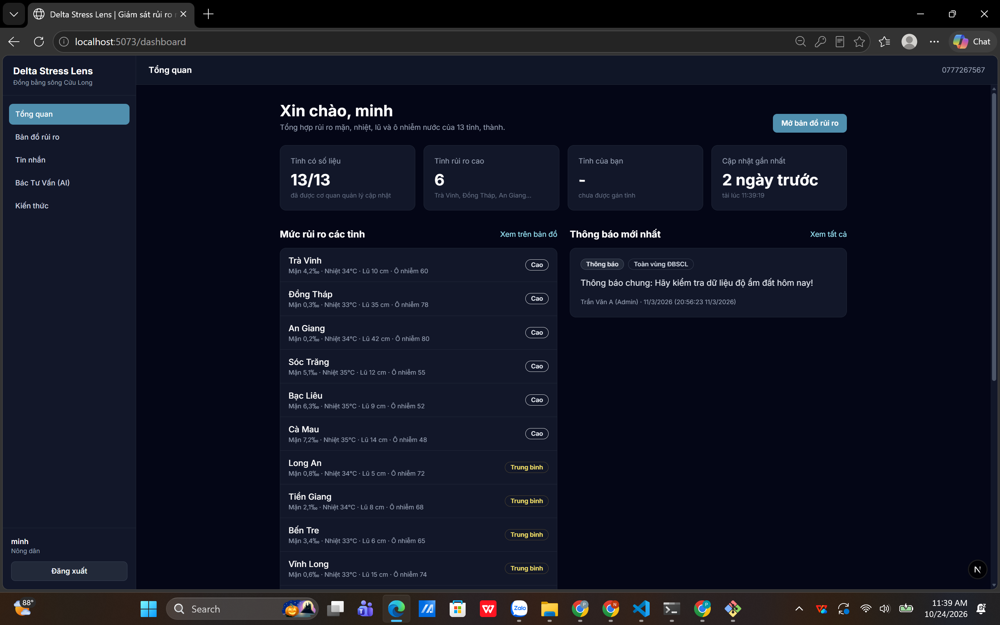
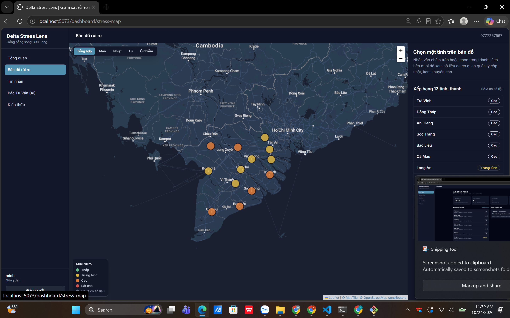
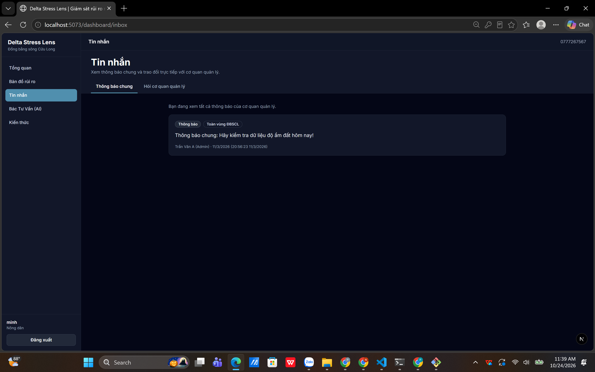
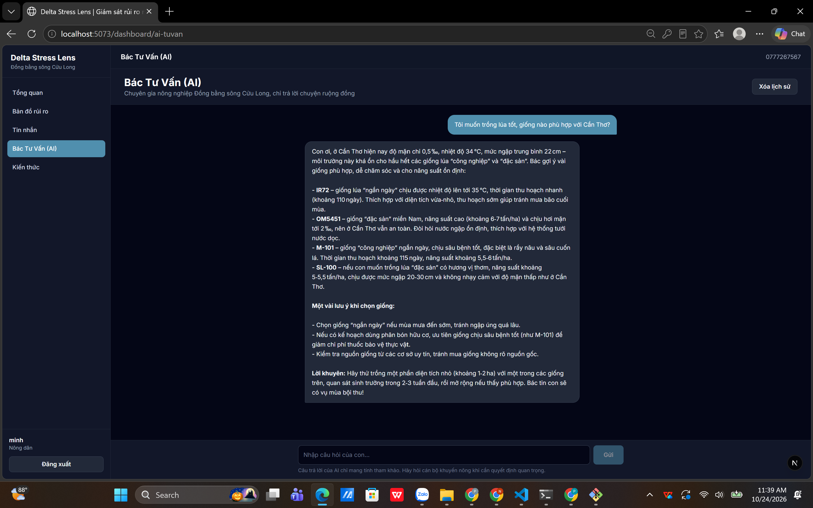
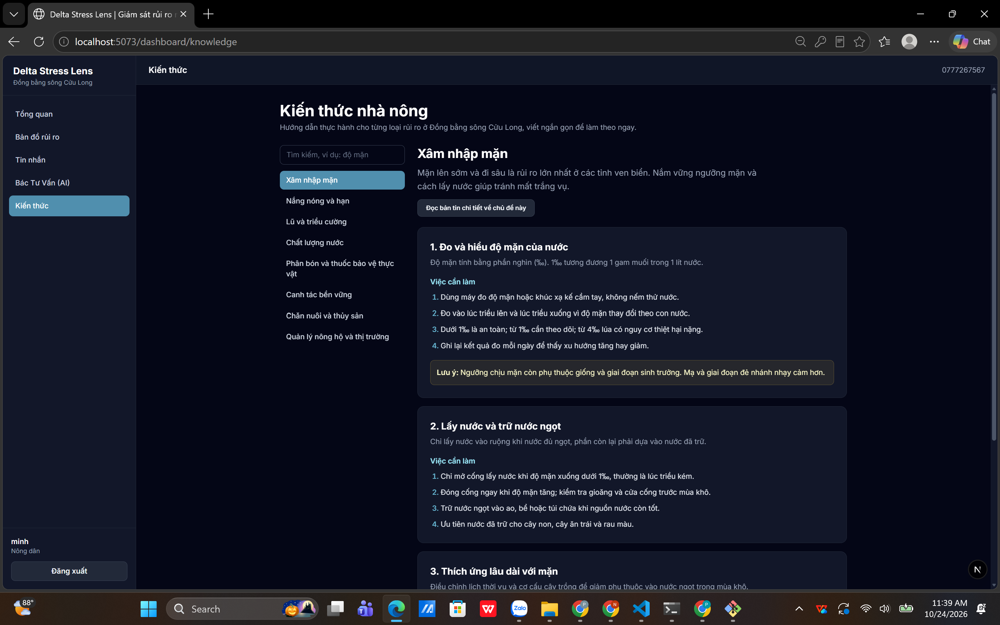
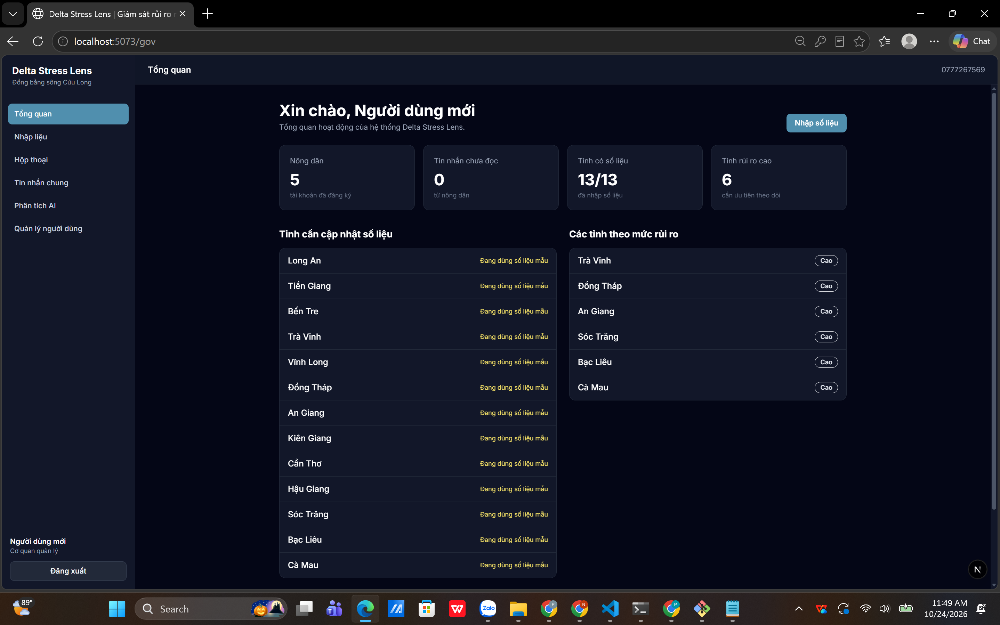
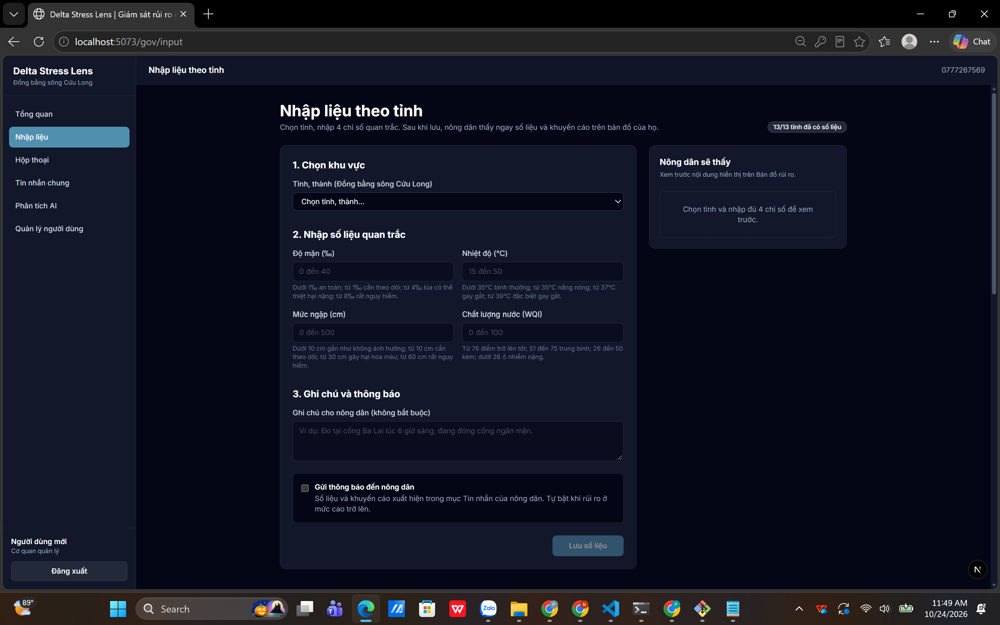
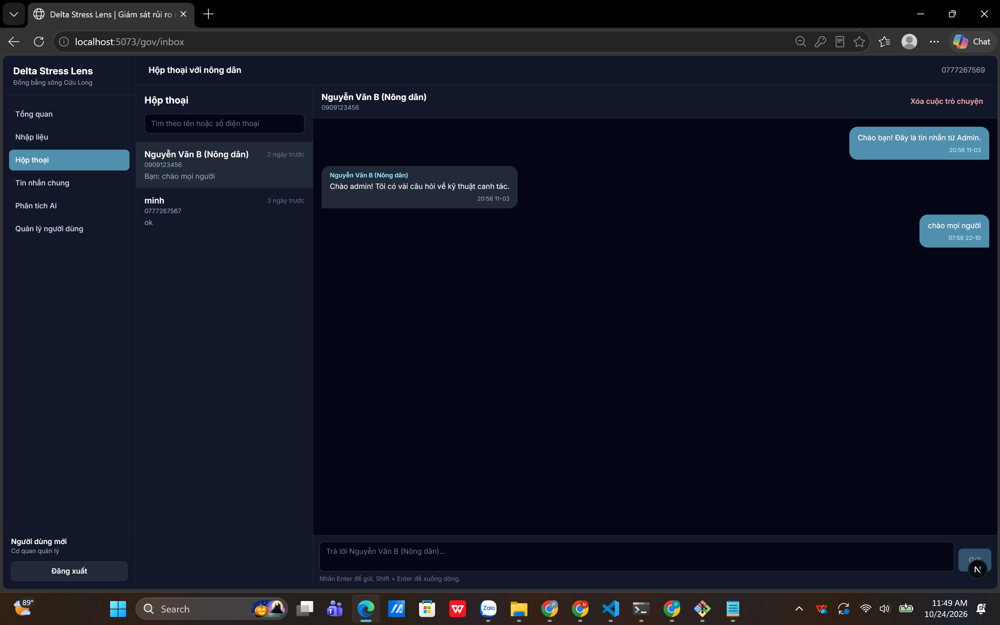
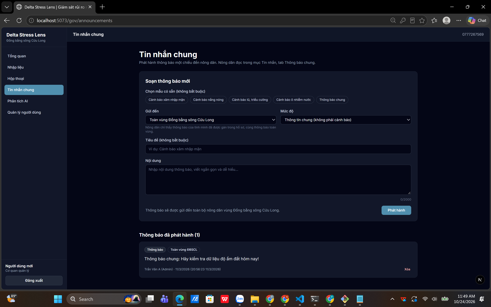
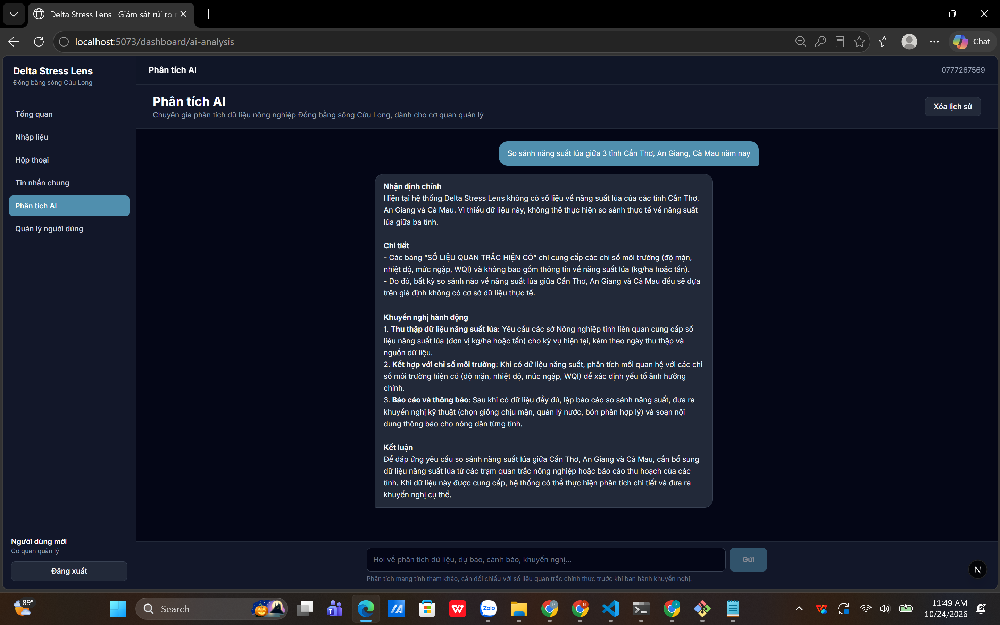

<div align="center">

# Delta Stress Lens

### Giám sát rủi ro môi trường Đồng bằng sông Cửu Long

*Xâm nhập mặn · Nắng nóng · Ngập lụt, triều cường · Ô nhiễm nước*

<!-- Sửa tên cuộc thi nếu cần -->


</div>

---

## Giới thiệu

**Delta Stress Lens** là một nền tảng phân tích và trực quan hóa rủi ro môi trường dành cho khu vực Đồng bằng sông Cửu Long, nơi đang chịu tác động đồng thời của **xâm nhập mặn, nắng nóng, ngập lụt và ô nhiễm**.

Cơ quan quản lý nhập số liệu quan trắc theo từng tỉnh. Nông dân thấy ngay mức rủi ro trên bản đồ, nhận cảnh báo kèm khuyến cáo canh tác, và có thể hỏi **Bác Tư Vấn (AI)** hoặc trao đổi trực tiếp với cán bộ.

---

## Giao diện

### Dành cho nông dân

<table>
  <tr>
    <td width="50%"><br><sub><b>Tổng quan</b> · mức rủi ro 13 tỉnh và thông báo mới nhất</sub></td>
    <td width="50%"><br><sub><b>Bản đồ rủi ro</b> · mỗi tỉnh một điểm tô màu theo mức rủi ro</sub></td>
  </tr>
  <tr>
    <td width="50%"><br><sub><b>Tin nhắn</b> · thông báo chung và hỏi cơ quan quản lý</sub></td>
    <td width="50%"><br><sub><b>Bác Tư Vấn (AI)</b> · tư vấn dựa trên số liệu hiện có</sub></td>
  </tr>
  <tr>
    <td colspan="2"><br><sub><b>Kiến thức nhà nông</b> · hướng dẫn thực hành theo từng loại rủi ro</sub></td>
  </tr>
</table>

### Dành cho cơ quan quản lý

<table>
  <tr>
    <td width="50%"><br><sub><b>Tổng quan</b> · tỉnh cần cập nhật, tỉnh rủi ro cao</sub></td>
    <td width="50%"><br><sub><b>Nhập liệu</b> · 4 chỉ số quan trắc, xem trước nội dung nông dân sẽ thấy</sub></td>
  </tr>
  <tr>
    <td width="50%"><br><sub><b>Hộp thoại</b> · trao đổi trực tiếp với từng nông dân</sub></td>
    <td width="50%"><br><sub><b>Tin nhắn chung</b> · phát hành thông báo theo mẫu, theo tỉnh hoặc toàn vùng</sub></td>
  </tr>
  <tr>
    <td colspan="2"><br><sub><b>Phân tích AI</b> · trợ lý phân tích số liệu, dự báo và khuyến nghị cho cán bộ</sub></td>
  </tr>
</table>

---

## Tính năng chính

### Nông dân

- **Bản đồ rủi ro** theo thời gian thực, lọc theo *Tổng hợp · Mặn · Nhiệt · Lũ · Ô nhiễm*
- Bấm vào từng tỉnh để xem số liệu do cán bộ nhập, ghi chú và khuyến cáo
- Nhận thông báo riêng khi tỉnh ở mức rủi ro cao trở lên
- Hỏi cơ quan quản lý và đọc thông báo chung của toàn vùng
- **Bác Tư Vấn (AI)**: hỏi giống lúa, lịch xuống giống, cách xử lý khi mặn lên
- **Kiến thức nhà nông** và các bản tin có ảnh minh họa

### Cơ quan quản lý

- **Nhập liệu theo tỉnh** (13 tỉnh, thành) với 4 chỉ số, kiểm tra khoảng giá trị hợp lệ
- **Phát hành thông báo** có mẫu sẵn: xâm nhập mặn, nắng nóng, lũ triều cường, ô nhiễm nước
- **Hộp thoại** hai chiều với nông dân, tìm theo tên hoặc số điện thoại
- **Phân tích AI** trên dữ liệu quan trắc hiện có
- **Quản lý người dùng** và đổi vai trò
- Số liệu mẫu để demo: `npm run seed:regions`

---

## Ngưỡng cảnh báo

| Chỉ số | An toàn | Theo dõi | Nguy hiểm | Rất nguy hiểm |
|---|---|---|---|---|
| **Độ mặn (‰)** | dưới 1 | từ 1 | từ 4 (lúa có thể thiệt hại nặng) | từ 8 |
| **Nhiệt độ (°C)** | dưới 35 | từ 35 (nắng nóng) | từ 37 (gay gắt) | từ 39 |
| **Mức ngập (cm)** | dưới 10 | từ 10 | từ 30 (hại hoa màu) | từ 60 |
| **Chất lượng nước (WQI)** | 76 trở lên (tốt) | 51 đến 75 (trung bình) | 26 đến 50 (kém) | dưới 26 (ô nhiễm nặng) |

Mức rủi ro của mỗi tỉnh: Thấp · Trung bình · Cao · Rất cao · Chưa có số liệu.

> Ngưỡng nằm ở `src/lib/risk.ts` (frontend) và `backend/src/config/risk.ts` (backend). Hai file này phải giữ giống nhau.

---

## Luồng dữ liệu & kiến trúc

```text
  Cán bộ (Nhập liệu)
          │
          ▼
┌───────────────────┐   REST    ┌───────────────────┐
│  Next.js  :5073   │ ◄───────► │  Backend API :3001 │ ◄──► MongoDB
│  React · Leaflet  │           │  Node.js · JWT     │
└───────────────────┘           └───────────────────┘
          ▲                               │
          └──────── Socket.io ◄───────────┘
                (cập nhật realtime theo phòng người dùng)
          │
          ▼
  Bản đồ rủi ro · Tin nhắn · Bác Tư Vấn (AI) · Kiến thức
```

1. Cán bộ chọn tỉnh, nhập 4 chỉ số, ghi chú, tích *Gửi thông báo đến nông dân* (tự bật khi rủi ro từ mức cao).
2. Số liệu lưu vào **MongoDB**.
3. Backend phát sự kiện realtime, **bản đồ của nông dân tự cập nhật** mà không cần tải lại trang.
4. Nếu bật thông báo, nông dân nhận thêm một tin chứa số liệu trong mục Tin nhắn.

---

## Công nghệ

| Lớp | Công nghệ |
|---|---|
| **Frontend** | Next.js 16 (Turbopack), React 18, TypeScript, Tailwind CSS, Framer Motion, Zustand, Recharts, react-i18next, next-themes |
| **Bản đồ** | Leaflet, react-leaflet, nền bản đồ MapTiler (dữ liệu © OpenStreetMap) |
| **Backend** | Node.js, TypeScript, REST API, JWT, Socket.io |
| **Cơ sở dữ liệu** | MongoDB (Mongoose) |
| **Email** | Nodemailer (SMTP) để gửi mã OTP |
| **AI** | Mô hình ngôn ngữ lớn qua API, khóa đặt trong `.env.local` |
| **Triển khai** | Vercel (frontend), Railway (backend) |

---

## Bảo mật

- Mật khẩu băm, đăng nhập bằng **JWT**
- **OTP email** khi đăng ký: hiệu lực 45 giây, nhập tối đa 2 lần, khóa gửi và nhập 60 giây khi sai lần 2, chống bấm gửi dồn dập. Mọi giới hạn kiểm tra ở backend (`backend/src/config/security.ts`)
- Số điện thoại đúng **10 số**, bắt đầu bằng 0, kiểm tra ở giao diện, API và model
- Socket.io yêu cầu đăng nhập, chia phòng theo người dùng nên tin nhắn riêng không lộ sang người khác
- CORS theo danh sách cho phép, khi dev cho phép `localhost` và mạng LAN
- Nhật ký che mật khẩu, OTP và token thành `***`
- Không đưa `.env`, `.env.local`, `node_modules`, `logs` lên Git

---

## Chạy thử trên máy

**Yêu cầu:** Node.js 22 trở lên, một cơ sở dữ liệu MongoDB (MongoDB Atlas miễn phí là đủ).

```bash
# 1. Cài thư viện
npm install
cd backend && npm install && cd ..

# 2. Tạo file cấu hình từ file mẫu rồi điền giá trị của bạn
cp .env.example .env.local
cp backend/.env.example backend/.env

# 3. Chạy backend (cổng 3001)
cd backend && npm run dev

# 4. Mở cửa sổ khác, chạy web (cổng 5073) ở thư mục gốc
npm run dev
```

Kiểm tra backend: mở `http://localhost:3001/health`, phải thấy `"db":"connected"`. Web chạy ở `http://localhost:5073` (dùng `localhost`, đừng dùng địa chỉ IP).

**Biến môi trường chính** (tên biến, không có giá trị thật):

| File | Biến | Mục đích |
|---|---|---|
| `backend/.env` | `MONGO_URI` | Kết nối MongoDB |
| `backend/.env` | `JWT_SECRET` | Khóa ký token |
| `backend/.env` | `SMTP_HOST`, `SMTP_PORT`, `SMTP_USER`, `SMTP_PASS`, `MAIL_FROM` | Gửi OTP. Gmail cần *Mật khẩu ứng dụng* 16 ký tự |
| `backend/.env` | `FRONTEND_URL` | Địa chỉ web được phép gọi API |
| `.env.local` | `NEXT_PUBLIC_MAPTILER_KEY` | Nền bản đồ MapTiler |
| `.env.local` | `GEMINI_API_KEY` | Khóa AI cho Bác Tư Vấn |

> Chưa cấu hình SMTP khi đang dev thì mã OTP được in ra cửa sổ console của backend để vẫn thử được.

**Lệnh hữu ích**

```bash
cd backend
npm run seed:regions     # tạo số liệu mẫu cho 13 tỉnh
npm run test:otp         # kiểm thử logic OTP

npm run fetch:news-images   # (thư mục gốc) tải ảnh bản tin từ Wikimedia Commons
```

---

## Cấu trúc thư mục

```text
Mekong-Delta/
├── src/
│   ├── app/            # Trang Next.js: auth, dashboard (nông dân), gov (cơ quan), tin-tuc
│   ├── components/     # Thành phần giao diện, bản đồ rủi ro
│   ├── lib/            # Ngưỡng rủi ro, tiện ích
│   └── data/           # Nội dung bản tin
├── backend/
│   └── src/
│       ├── config/     # Bảo mật, ngưỡng rủi ro, kết nối DB
│       ├── models/     # Mongoose models
│       ├── routes/     # API: auth, dữ liệu, tin nhắn
│       ├── middleware/ # Xác thực
│       └── utils/      # JWT, OTP
├── public/             # Ngôn ngữ (locales) và ảnh bản tin
├── scripts/            # Tiện ích (tải ảnh bản tin...)
├── image_web/          # Ảnh chụp giao diện dùng trong README
└── docx/               # Tài liệu dự án
```

---

## Lộ trình

- [x] Bản đồ rủi ro realtime theo tỉnh
- [x] Nhập liệu cho cơ quan quản lý, thông báo và hộp thoại
- [x] Bác Tư Vấn (AI) và Phân tích AI
- [ ] Số liệu **tự cập nhật** từ nguồn dữ liệu mở, giảm nhập tay
- [ ] Mô hình dự báo xâm nhập mặn
- [ ] Lịch sử hội thoại AI theo từng người dùng
- [ ] Chế độ sáng, tối
- [ ] **Chế độ khách**: xem nhanh, không lưu tài khoản
- [ ] Đăng ký nông dân gọn hơn (số điện thoại, tên, mật khẩu), tăng xác thực cho cơ quan quản lý

---

## Ghi nhận

- Nền bản đồ: © [MapTiler](https://www.maptiler.com/copyright/) © [OpenStreetMap contributors](https://www.openstreetmap.org/copyright)
- Ảnh bản tin: tải từ Wikimedia Commons, tác giả được ghi ở cuối từng bài
- Phát triển bởi [@phuc123-hn](https://github.com/phuc123-hn)

<div align="center">

Nếu thấy dự án hữu ích, hãy để lại một ngôi sao nhé!

</div>
